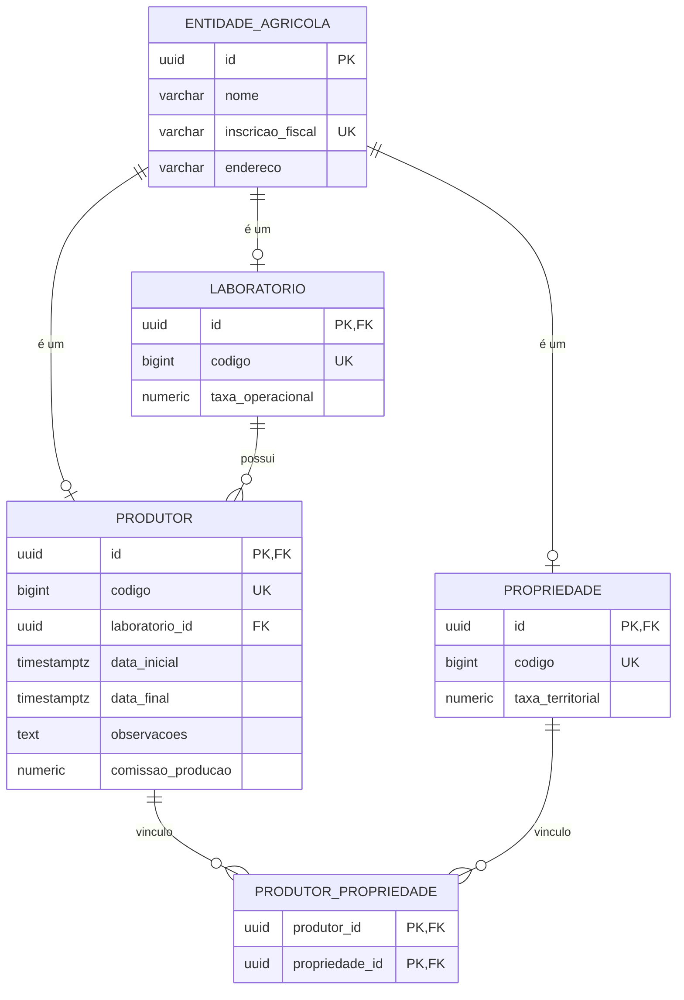

# 🌱 Painel de Gestão Agrícola

Aplicação full stack para cadastro de produtores, propriedades e laboratórios, com cálculo financeiro por entidade e um relatório consolidado por laboratório.

---

## 🚀 Para quem vai avaliar: comece aqui

### Pré-requisitos

| Ferramenta | Obrigatório? | Observação |
|---|---|---|
| [Docker](https://docs.docker.com/get-docker/) | Sim | Sobe o PostgreSQL (e é usado pelos testes com Testcontainers) |
| Java 17+ | Sim | Para rodar a API |
| Node.js 20+ | Sim | Para rodar o front-end |

### Passo 1: subir o banco

```bash
docker compose up -d
```

PostgreSQL em `localhost:5432`, banco `agrotis`, usuário e senha `postgres`.

### Passo 2: subir a API

```bash
cd backend
./mvnw spring-boot:run
```

Ao iniciar, o Flyway cria as tabelas e aplica a carga de exemplo (laboratórios, fazendas e produtores).

### Passo 3: subir o front-end

```bash
cd frontend
npm install
npm run dev
```

| Serviço | URL |
|---|---|
| **Front-end (abra este)** | http://localhost:5173 |
| API | http://localhost:8080 |
| Swagger | http://localhost:8080/swagger-ui.html |

### Passo 4: roteiro rápido de teste

1. **Cadastrar:** crie um produtor, selecione uma ou mais propriedades e um laboratório.
2. **Editar e excluir:** use as ações da listagem.
3. **Validação:** tente salvar com a data final anterior à inicial.
4. **Painel de indicadores:** aplique os filtros (datas, texto, mínimo de produtores) e confira a ordenação.

### Passo 5: rodar os testes

```bash
cd backend
./mvnw test
```

> Os testes de integração usam Testcontainers, que cria um PostgreSQL temporário no Docker durante a execução. Por isso o Docker precisa estar rodando.

---

## 🧩 O que foi implementado

| Área | Detalhes |
|---|---|
| **CRUD de Produtor** | Cadastro, edição, listagem e exclusão, com vínculo a N propriedades e 1 laboratório |
| **Seletores** | Endpoints de apoio para os dropdowns de propriedades e laboratórios |
| **Cálculo financeiro** | `GET /api/entidades/{id}/valor-financeiro` |
| **Relatório analítico** | `GET /api/laboratorios/analitico`, com filtros, agregação e ordenação no banco |
| **Front-end** | Formulário, listagem e painel de indicadores, com estados de carregamento, erro e vazio |
| **Documentação** | Swagger/OpenAPI |

## 🛠️ Stack

| Camada | Tecnologia |
|---|---|
| Back-end | Java 17, Spring Boot 3.5, Spring Data JPA |
| Banco | PostgreSQL 16, Flyway |
| Front-end | React, TypeScript, Vite |
| Testes | JUnit 5, Testcontainers |

---

## 🗄️ Modelo de dados

Produtor, Propriedade e Laboratório compartilham os mesmos dados de identidade: nome, inscrição fiscal e endereço. Em vez de repetir essas colunas em três tabelas, elas ficam em `entidade_agricola`, e cada entidade tem sua própria tabela ligada pelo mesmo `id` (herança JPA `JOINED`). Assim não há dado duplicado, e o banco garante a integridade com chaves estrangeiras reais.



**Regras garantidas pelo banco:**
- A inscrição fiscal é única na tabela base, e o `codigo` é único em cada tabela filha.
- Todo produtor tem obrigatoriamente um laboratório (`laboratorio_id NOT NULL`).
- O vínculo produtor-propriedade é N:N, com chave composta para não duplicar.

As entidades ficam em `backend/src/main/java/br/com/agrotis/painel/entity`.


