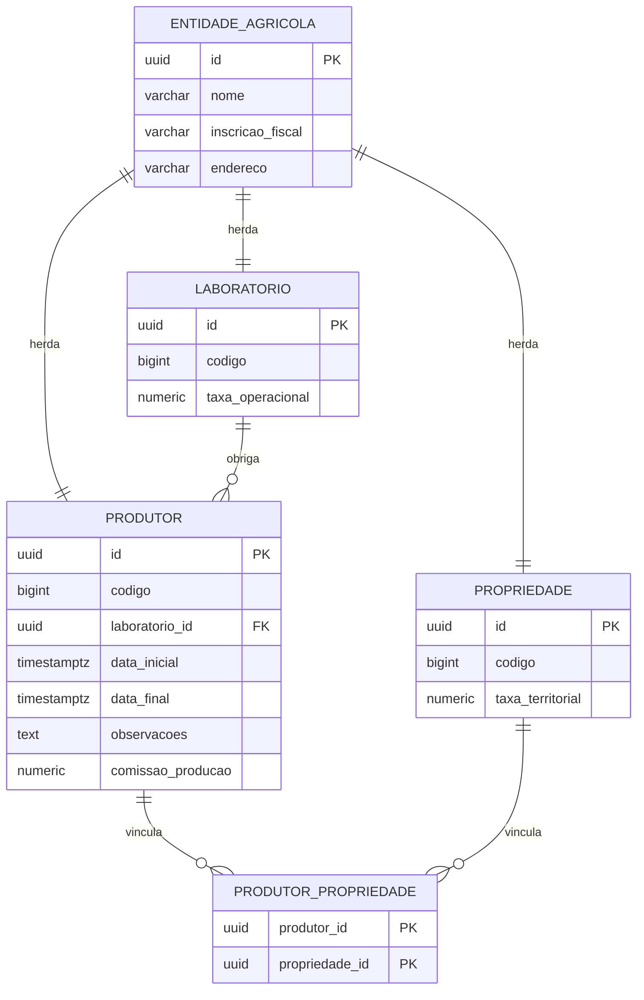

# Painel de gestão agrícola

Cadastro de produtores, propriedades e laboratórios, com cálculo financeiro e um relatório por laboratório.

## Stack

- Back-end: Java 17 e Spring Boot 3.5
- Front-end: React e TypeScript
- Banco: PostgreSQL 16, com Flyway

## Sobre

Nome, inscrição fiscal e endereço ficam numa tabela só. Produtor, propriedade e laboratório usam o mesmo identificador. As classes Java em `backend/src/main/java/br/com/agrotis/teste/entity` apontam para essas tabelas.

A API cobre o cadastro do produtor. A interface tem formulário, lista e um painel do relatório. O cálculo financeiro fica em cada tipo de cadastro. O relatório de laboratórios agrega no próprio banco.

## Modelo de dados

Nome, inscrição fiscal e endereço ficam em `entidade_agricola`. As três filhas compartilham o mesmo `id` (herança `JOINED`). O `codigo` numérico é da filha. A URL da API usa o UUID.



Inscrição fiscal é única no pai. `codigo` é único em cada filha. Produtor tem um laboratório obrigatório e várias propriedades.

## Banco

```bash
docker compose up -d
```

Postgres em `localhost:5432`, banco `agrotis`, usuário e senha `postgres`.
