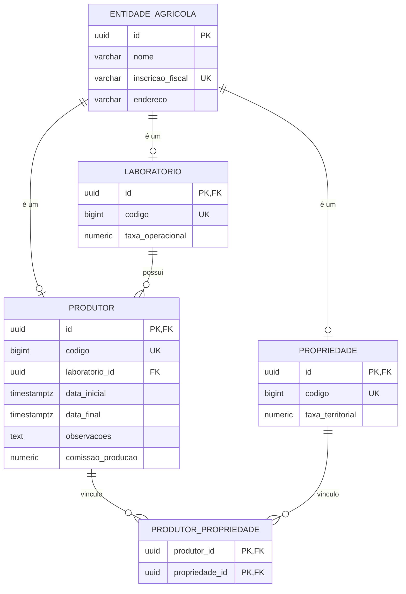

# 🌱 Painel de Gestão Agrícola

Aplicação full stack para cadastro de produtores, propriedades e laboratórios, com cálculo financeiro por entidade e um relatório consolidado por laboratório.

---

## 🚀 Para quem vai avaliar: comece aqui

Banco, API e front-end ficam no ar ao mesmo tempo, cada um no seu terminal. Os comandos partem da **raiz do repositório**.

O Docker precisa estar rodando, não só instalado: Docker Desktop no macOS e no Windows; no Linux, o serviço `docker`. `docker compose` e `npm` são iguais nos três. Só o Maven Wrapper muda.

| | Linux e macOS | Windows (PowerShell) |
|---|---|---|
| API | `./mvnw spring-boot:run` | `mvnw.cmd spring-boot:run` |
| Testes | `./mvnw test` | `mvnw.cmd test` |

Se o `./mvnw` recusar permissão no Linux ou no macOS:

```bash
chmod +x backend/mvnw
```

### Pré-requisitos

| Ferramenta | Obrigatório? | Observação |
|---|---|---|
| [Docker](https://docs.docker.com/get-docker/) | Sim | Sobe o PostgreSQL (e é usado pelos testes com Testcontainers) |
| Java 17+ | Sim | Para rodar a API |
| Node.js 20+ | Sim | Para rodar o front-end |

### Passo 1: subir o banco

Na raiz:

```bash
docker compose up -d
```

PostgreSQL em `localhost:5432`, banco `agrotis`, usuário e senha `postgres`. Este processo pode ir para segundo plano; os dois próximos não.

### Passo 2: subir a API

Em **outro terminal**, na raiz.

Linux e macOS:

```bash
cd backend
./mvnw spring-boot:run
```

Windows (PowerShell):

```powershell
cd backend
mvnw.cmd spring-boot:run
```

Ao iniciar, o Flyway cria as tabelas e aplica a carga de exemplo (laboratórios, fazendas e produtores). Deixe este terminal aberto.

### Passo 3: subir o front-end

Em um **terceiro terminal**, na raiz. Igual nos três sistemas:

```bash
cd frontend
npm install
npm run dev
```

Deixe este terminal aberto e acesse:

| Serviço | URL |
|---|---|
| **Front-end (abra este)** | http://localhost:5173 |
| API | http://localhost:8080 |
| Swagger | http://localhost:8080/swagger-ui.html |

### Passo 4: roteiro rápido de teste

1. **Cadastrar:** crie um produtor, selecione uma ou mais propriedades e um laboratório.
2. **Editar e excluir:** use as ações da listagem.
3. **Validação:** tente salvar com a data final anterior à inicial.
4. **Painel de indicadores:** aplique os filtros (datas, texto, mínimo de produtores) e confira a ordenação.

### Passo 5: rodar os testes

Em um terminal na raiz.

Linux e macOS:

```bash
cd backend
./mvnw test
```

Windows (PowerShell):

```powershell
cd backend
mvnw.cmd test
```

> Os testes de integração usam Testcontainers, que cria um PostgreSQL temporário no Docker durante a execução. Por isso o daemon do Docker precisa estar rodando.

---

## 🧩 O que foi implementado

| Área | Detalhes |
|---|---|
| **CRUD de Produtor** | Cadastro, edição, listagem e exclusão, com vínculo a N propriedades e 1 laboratório |
| **Seletores** | Endpoints de apoio para os dropdowns de propriedades e laboratórios |
| **Cálculo financeiro** | `GET /api/entidades/{id}/valor-financeiro` |
| **Relatório analítico** | `GET /api/laboratorios/analitico`, com filtros, agregação e ordenação no banco |
| **Front-end** | Formulário, listagem e painel de indicadores, com estados de carregamento, erro e vazio |
| **Documentação** | Swagger/OpenAPI |

## 🛠️ Stack

| Camada | Tecnologia |
|---|---|
| Back-end | Java 17, Spring Boot 3.5, Spring Data JPA |
| Banco | PostgreSQL 16, Flyway |
| Front-end | React, TypeScript, Vite |
| Testes | JUnit 5, Testcontainers |

---

## 🗄️ Modelo de dados

Produtor, Propriedade e Laboratório compartilham os mesmos dados de identidade: nome, inscrição fiscal e endereço. Em vez de repetir essas colunas em três tabelas, elas ficam em `entidade_agricola`, e cada entidade tem sua própria tabela ligada pelo mesmo `id` (herança JPA `JOINED`). Assim não há dado duplicado, e o banco garante a integridade com chaves estrangeiras reais.



**Regras garantidas pelo banco:**
- A inscrição fiscal é única na tabela base, e o `codigo` é único em cada tabela filha.
- Todo produtor tem obrigatoriamente um laboratório (`laboratorio_id NOT NULL`).
- O vínculo produtor-propriedade é N:N, com chave composta para não duplicar.

As entidades ficam em `backend/src/main/java/br/com/agrotis/painel/entity`.


## 🧠 Decisões e trade-offs

**Herança `JOINED`.** Optei por centralizar nome, inscrição fiscal e endereço numa tabela base. Evita duplicar dados e mantém as restrições de cada entidade no próprio banco. O preço é um JOIN a mais, que considero justo para esse escopo.

**UUID v7 + `codigo`.** Usei dois identificadores com papéis diferentes: o UUID v7 na API, pra não expor sequência e não prejudicar os índices, e o `codigo` numérico pra exibição. O Hibernate 6.6 ainda não gera v7, então utilizei `uuid-creator`.

**Cálculo financeiro sem `if` de tipo.** Cada entidade sabe calcular o próprio valor. Se amanhã entrar uma entidade nova, ela traz a própria regra, sem mexer no que já existe.

**Relatório resolvido no banco.** Filtro, agregação e ordenação ficam na consulta, sem nada carregado em memória. Tive um cuidado especial com a contagem de produtores, que poderia sair duplicada.

**PostgreSQL + Flyway.** Escolhi o Postgres pelo tratamento de datas com fuso e por ser mais rigoroso com integridade. O schema é versionado em SQL, e não gerado pelo Hibernate.

**Testcontainers no lugar do H2.** Os testes de integração rodam num PostgreSQL de verdade, na mesma versão da aplicação. O H2 não tem `ILIKE` nem trata `timestamptz` igual, então um teste podia passar nele e falhar em produção.

**Nomes em português e inglês.** Mantive o domínio em português, igual ao enunciado, e a parte técnica em inglês, seguindo as convenções do Spring.

---

## 📌 Premissas

Onde o enunciado deixou espaço, tomei algumas decisões:

- O exemplo de payload do produtor não traz inscrição fiscal nem endereço, mas o requisito pede os três campos pra todas as entidades. 
- Como o enunciado não define fórmulas, cada entidade devolve o valor já gravado no banco (comissão, taxa territorial ou taxa operacional), como resultado final. A estrutura permite trocar a regra de uma entidade sem mexer no resto.
- O produtor só vincula propriedades e laboratório pelo `id`, sem alterar os dados deles.
- A inscrição fiscal é única no sistema todo. Pensei em liberar por tipo de cadastro (fazenda no CPF do próprio produtor), mas mantive a regra mais restrita por enquanto.

---

## 🤖 Uso de IA

O enunciado permite usar IA e pede para descrever como. Usei como par de programação: ela escrevia o código, e eu definia a arquitetura, revisava e só subia o que eu pudesse entender e validar.

Os prompts, o que eu mantive e o que eu corrigi estão em [docs/prompts.md](docs/prompts.md).
